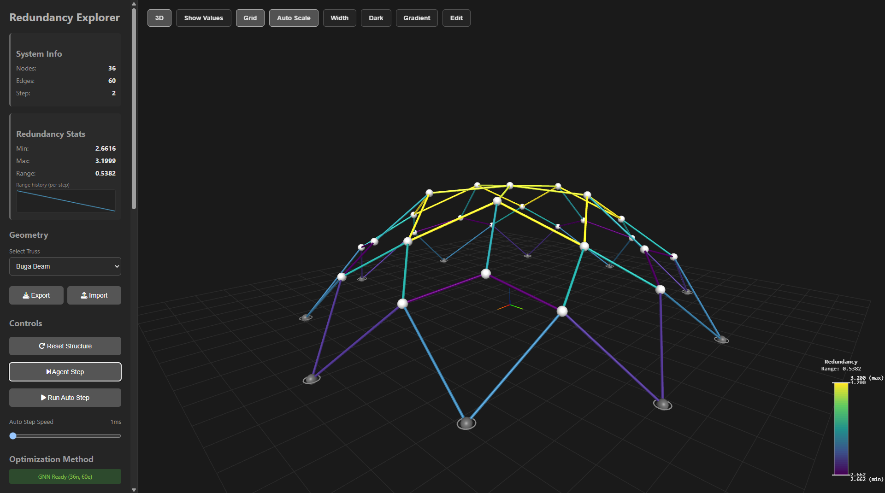
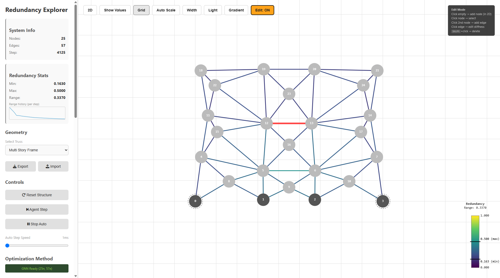

# Redundancy Explorer: Interactive Browser Application for Design Space Exploration Guided by Redundancy Matrices

[![DaRUS DOI](https://img.shields.io/badge/DaRUS%20DOI-10.18419%2Fdarus--6512-blue?style=flat&logo=data:image/png;base64,iVBORw0KGgoAAAANSUhEUgAAADAAAAAwCAYAAABXAvmHAAAKGklEQVR42sXZBXgbR9oH8C0//H3HzHdhpjIzh8qtmQNmyyE7TI6ZXQgzozEM5iPHkklsFDNL782upNm1slbkOvA+z/+u3P6y89+ZWRP3YoxNlb/VHNryqaoiIVtVGletKo7t0pTEaDUFQQ5tYZBLVxZj0H0bL9J/t/yqYXd6mfHEjnBra9U4AHiEeFhjvH3zJ8rdmXHy/Mibso0fWGVrXwH5utdAvv51UGx4E5Qb3wLVprdBvfkdUG99FzRb3wPttvdBu/1D0GV9BPq8z5zGH+K5puPbMm3/vfxn4kGNvrn6N7IKTvbApoXq/lUvwsDql2BwzcswlPEKyNa+SiJQSMQbCIEgCKEiEVtIxLsexAcUQrfjYzDkzAdjcbDVfHjDQds/a6YS92ss0q4n5Xs2JPdvWKDuS38O+lY8D/0rX4D+VS8MR2SSkNcoCELgp8GG0GZ9iBDoaWTPR5AFYCwJtlpO5RQ7RG0/Je7lqC8fHd+fHV0vTXsaetOegd70Z8GNQFn5vA/iZQ/iVTdi/R0IvKQwIouByF0I5t3JYmvDmTeJezHyk2UfSzLnq8TJc0GSMg+kqR4Eh4L4IF7EiCGMYOnFlhF6kf0xRphKQmzWS3vTAeBR4seMy2Z5ZOhocbSI85pNlDgbRElzgESIEULig8BLCiG8vUAIFCaCpRckAoWBwL0wIISx4DOwVH1b7LKanxg1YOhYSbQw5WWHIH4WCBNmg9CLcEMQYh5QS8oXsRIjWHpBIVBIRAC9yEVPI28xWKq/KweAxwL/jz9ZMV+Q/IqNv2wGCJbPBDcCxY2g4l1Sg2XpoL1ZCdpbVaBDURzMhj4SseZV0NQcAH1DNRi8aawGI5UaKqYmMrVgbnbHQqalzp3GSjCUx7qXVP6nYLm8bwO4XHffN1RXT08SrPxY3RM3HXqWTAeMWI4A8V6Ed0nNAUu/EJijb7lK9UJxIAvGOta2G3QvioMc1ubKxf5flQOip0TbYhq7Y6dAd9xU6ImbhhH85W6I0LOkvL1QnNkJJlEXOIx6IEeHAOSSUh4vBXJcDjtYJN04VpwesErp2BhxGjRuAK9x+H6xM1lul/D+MCKgb892Tlf0FOiKQQBfxFIaIcAIby/mgrH7Ng1AvVAcLwFyHAYd6sVzo+qFhdvoBqD/d296H2KE+VzxSdYjiPbfN37fk/6RtjN6MoyMQGHvBQK0uQHNV6hyK455AVq0pFDJ2Tc91v3C0t7gATTcsV8YCr502tquvn0HQFKakd8ROQk6o1AQAoVCdJGIWBJBxrcXGIEBWgQgyy0/ygCkPzOq/YIJoPcLGmE8nlUPTju9Pxj5bT/vSvtY1xExEZgI9qfB3gsDDaDeUExAL2ee51WLESgk4iVWhNkDQBD2w2DeF2DjNbyMAdKd2+J54ROAFz4ReDQChQ3B3gtDFwZQS0p2pBgDpKlzA9sv1rp7Yb5NASjISIdB45migxjA3xLXxA1DAB8ESgAIFITwAjRNV6glxQRIUuawbHrPjXQYRIB6DGA7DGq2vQf675N1Lovh/wntf+v/wFv2qo0EeIMREUwEmSnsvUAIBoDqxZAXoNeiJTWbcY7CiBF7YfIAEASXG5+jvIdBtJQsrbXzid6DhV+2h4yD9tDxwA31QaD478VU/DQYAKrcQ4dpgChpFoziMIgB6P/9XpIM50oLCGEeJ789ZDygsCA8kADKrbx6DsDlBNnpXdSSGjxcBOTYSUDiTJ/D4DyMYOuFsQ0D/F6SdIe3NhL8bcvrMIBCoGDEKHqxBJV51ULUixlULwYO0QBh/IzRHAYR4JYbgCC++wXzkqTdu1ZPdK+P5NMAdoT/XjD2izi6FwMHaYBg+XT2wyB7LzAAPQm/lyRVfhAQ3Rujdb4AJkRWdxIMom4wkhH3+I2JEYusH5+FTJIeMLOGT8UiHR6HXuMB3PK/6aGnQHSt/sI5EoAbMRWcVgs8rNH/8+pdL0kI8PnIgMjpGKBsugqyi2dBdsk350BO5jIdBYr2dguQ47SYQXnlHJ2rZM6Dyptr50HtieY6I1fPwMDWr+56SSI7oAsEIMhOCqQXuNx9B+gO9MROZjsM+u2F76bHehhc+yoCrA3nBwwIYS03CkbgV23f/kIM6I6dRBWcn/ACDB4pBfmFQ+5UopzZBeLMhdQlqXd7BCgrD4Ky+jCoUGQ711OQkTY92fZPgejZFFMXOMD/fsHc9JiArpiJ1KtWz20FtrEpBkGU8gKYRJ3DO9B61e/HA/m36XqCnxWfHzgg8P2ilwmInogyieoDOTa1EiyyAbDKBwFcLiBHujUYFFWHwIr+uNNsAnJ0COBvv5DvzGgkJD9spY4SAQICRvTuowGdUROgK2oi/mf17syijh+C9LfBZbd5AKG4F4b2ZgzAvWA5DCoOZhUQqvqaP/Bin7eNEoDD3gsfQOR4CsEAUOcoAectDJAggPeSpKcB7Jse51nqKWgvH51PkNOd8U3TGACsvZDSANQNBIikAdIfsqjdm59GA8SbQ/AlyQvQtpCA2ayIgawQnUM1+P8UQFi4Mn7MAIy4E8ALH0chaMB26lXLT32TCcCXJAYAfzzwPQzKdq6lLzTqlss/5y1/XTdWALMX0r0MQNg4CsEAUK/aHgZAtCkYX5L0t2kA25dBCecl0N48+zLBHP7WJfn3AIARkr0FGMAN+wdC0ADJ9wgQhQApbzAAQfgwqPMANC1XWDe9/qLkeqdJN/yjr6z26O95S1/VjgjITUVnoxkBR7qviAaE/oMKBvywAzpjZkNP2rsYINwY5L0kIUCTG9B8xdsL/GUQ7RdOVe2htwm2Qb/KnBEA1L/IabMGHJfD5gMYBw6zEf+zXDYLihW8I1j7Bb5fMAG+Hw/6SjisH7ao0fzr2lOdnEWNzNejVSWHsYypV4j+Wf+g/lnK+ot442KOUdgJnbEz8TlKeb2SZIK89viwjweijIVybVPdHwh/g+7Ik3hxL6i9iI6U+SAoWPPjkr8aePFv0+UOmwj8rctAWLiGioj8/1wOdMTMHH4YjENLJScZdWIG7gU//jkH+nnFYiKQEZVkzOdGzMSb2z0NgnDDRvHxgLrpTYfeirUbXA5H4D+WFeQmR7eHT3Xce0Rgh0GMiJkKksK0cqdJ8xgxmrHpNY8IdsRHozfKvX4SgX88iJ4K4rykYuuQdPQ/YqKfRMrH3Oh5qvuLwMGIztg5NnFBWrrToH6UGOuIytaO74h/o/7eI9gPg52Jb4olFeveJO7lyCr3Ptm16rNkbtRs9f1BUPuOtTvjq+Kh8/t+StyvEVes+01n8gfZ6C11zyDciOnWzpQPD4rL104lHtRIKtb8pDP1wzhe7LM328OmWEf/Kz7JyYt7ntuZ+lGmuCzjz8TDHGF+ym8R5lPe0peyudFzq3lLX+niRs3UorVNvoZdaGkYeMteEaGXwVXe8tfK0H90uDA3cRy4jI8QY5z/AchS3TwlmrS4AAAAAElFTkSuQmCC)](https://doi.org/10.18419/darus-6512)

Redundancy Explorer is an interactive browser application for exploring
structural design spaces guided by redundancy matrices. Drag nodes, edit the
topology, or let an optimizer or a learned policy reshape the structure and
see in real-time how redundancy redistributes across its elements.



**[Open the app](https://redundancy-explorer.github.io)**

## Features

- **Runs in the browser**: the redundancy matrix is computed client-side in
  plain JavaScript, with no server and no installation
- **Real-time feedback**: drag nodes and watch the redundancy of every element,
  its min/max/range and range history update live
- **Trusses and frames**: truss and beam structures in 2D and 3D views
- **Topology editing**: add and remove nodes and elements, set supports and
  stiffnesses, undo/redo
- **Guided exploration**: a gradient optimizer based on adjoint gradients
  homogenizes the redundancy distribution, combined with design behaviors for
  segment length, angles and cross-section adaptation
- **Learned policy**: a topology-agnostic graph neural network (GNN) policy as
  an alternative to the gradient, which keeps working after topology edits
- **Import/export**: save and load structures as JSON

## Quick Start

Use the hosted version at [redundancy-explorer.github.io](https://redundancy-explorer.github.io), or run it
locally by serving the repository with any static HTTP server:

```bash
python -m http.server 8080
```

Then open ``http://localhost:8080`` in your browser. (Opening `index.html`
directly from the file system does not work, since the geometries and models
are loaded via `fetch`.)


## Using the App

### Exploring and Optimizing

- **Geometry**: pick a structure from the dropdown, or import/export one as JSON
- **Drag** free nodes to explore the design space by hand
- **Step** / **Auto** advance the optimizer by one or many steps; **Reset**
  restores the loaded structure
- **Gradient / Policy** (viewport toggle) switches between the gradient
  optimizer and the learned policy
- **Agent Behaviors** are weighted and combined:
  - *Redundancy Homogenization*: even out the redundancy distribution
  - *Target Segment Length* and *Min/Max Segment Length*: control element lengths
  - *Angle Constraint*: keep angles between elements within bounds
  - *Cross-Section Adaptation*: stiffen redundant elements,
    $EA \leftarrow (1 + \gamma r)\, EA$ (mean-normalized)
- **Viewport**: toggle 2D/3D, value labels, grid, auto color scale, element
  width (encodes $EA$ relative to the mean) and dark theme



### Edit Mode

Click **Edit** to modify the topology and node properties.

| Action | Result |
|--------|--------|
| Click empty space (2D) | Add node |
| Click node, then another node | Add element between them |
| Click element | Edit its stiffness |
| Shift+click node or element | Delete it (a node with its elements) |
| <kbd>Delete</kbd> | Delete the selection |
| <kbd>Esc</kbd> | Deselect |
| <kbd>Ctrl</kbd>+<kbd>Z</kbd> / <kbd>Ctrl</kbd>+<kbd>Y</kbd> | Undo / redo |

Clicking a node opens a popup with:

- **Fixed**: the node cannot be dragged or moved by the optimizer
- **Constraints (X, Y, Z)**: Dirichlet boundary conditions of the structural
  analysis

These two are independent: a node can be supported but movable, or free but
fixed in place.

## How It Works

The redundancy matrix is computed in pure JavaScript, following
[JaxRedMat](https://doi.org/10.18419/darus-6511):

1. **Compatibility matrix** $A$: maps nodal displacements to element
   deformations, one row per load-carrying mode (1 per truss element, 6 per
   beam element), reduced to the free DOFs of the Dirichlet boundary conditions
2. **Element stiffness matrix** $C$: diagonal, e.g. $EA / L$ for trusses
3. **Stiffness matrix** $K = A^\top C A$
4. **Redundancy matrix** $R = I - A (A^\top C A)^{-1} A^\top C$: its main
   diagonal gives the redundancy $r$ of each load-carrying mode, and the
   entries sum to the degree of static indeterminacy

For interaction, the app only evaluates the main diagonal,
$r = 1 - \operatorname{diag}(A K^{-1} A^\top C)$, without forming the full
matrix. The gradient optimizer uses adjoint gradients of the redundancy
distribution with respect to the node positions. The results match the
Python JAX implementation.

## Repository Structure

- `index.html`: web interface and styling
- `redundancy-matrix.js`: redundancy matrix, its main diagonal and adjoint
  gradients (`RedundancyMatrixTruss`, `RedundancyMatrixBeam`)
- `js/`: application code
  - `core.js`: app state and geometry loading
  - `redundancy.js`: bridge to the redundancy calculation
  - `render2d.js`, `render3d.js`: rendering
  - `editor.js`, `events.js`: edit mode and interaction
  - `optimizer.js`, `behaviors.js`, `policy.js`: gradient optimizer, behaviors
    and learned policy
- `policy_learning/`: GNN policy inference (`gnn_policy_inference.js`) and the
  trained GNN actors (ONNX)
- `geo/`: truss and beam geometries (JSON)

## Adding Geometries

1. Create a JSON file in `geo/`:
   ```json
   {
     "nodes": [
       {"id": 0, "x": 0, "y": 0, "z": 0, "fixed": true, "dirichlet_bc": [1, 1, 1]},
       {"id": 1, "x": 1, "y": 0, "z": 1, "fixed": false, "dirichlet_bc": [0, 0, 0]}
     ],
     "edges": [
       {"id": 0, "source": 0, "target": 1, "stiffness": 1.0}
     ]
   }
   ```
2. Add the filename to the fallback list in `loadAvailableGeometries` in
   `js/core.js` (needed on hosts without directory listings, such as GitHub
   Pages)
3. Reload the page and select the geometry from the dropdown

Alternatively, load a file ad hoc with **Import** without adding it to the
repository.

## Third-party software and data

The app runs in any modern web browser and needs no installation; no proprietary software was used. The following open-source libraries are loaded from public CDNs at runtime and are not part of this dataset:

- [three.js](https://threejs.org) r128 with OrbitControls and CSS2DRenderer (MIT License)
- [ONNX Runtime Web](https://onnxruntime.ai) 1.17.0 (MIT License)
- [Font Awesome Free](https://fontawesome.com) 6.5.1 (icons CC BY 4.0, code MIT License)

The GNN models in `policy_learning/models` were trained by the authors with PyTorch (open source) and exported to ONNX. The geometries in `geo/` were created by the authors; `buga_beam` is a simplified beam model of the BUGA Fibre Pavilion 2019 (ICD/ITKE, University of Stuttgart).

## Citation

If you use or reference Redundancy Explorer in your research, please cite:

```bibtex
@data{RedundancyExplorer,
  author    = {Kannenberg, Fabian and Forster, David and Bischoff, Manfred and Menges, Achim},
  publisher = {DaRUS},
  title     = {{Redundancy Explorer: Interactive Browser Application for Design Space Exploration Guided by Redundancy Matrices}},
  year      = {2026},
  doi       = {10.18419/darus-6512},
  url       = {https://doi.org/10.18419/darus-6512},
  version   = {V1},
}
```

## Contributors

- Fabian Kannenberg, Institute for Computational Design and Construction (ICD), University of Stuttgart
- David Forster, Institute for Structural Mechanics (IBB), University of Stuttgart

## Acknowledgements

The application was developed within the context of the [Cluster of Excellence Integrative Computational Design and Construction for Transformative Architecture (IntCDC)](https://www.intcdc.uni-stuttgart.de/) as part of the research project [RP12-2: Computational Co-Design Framework for Fibre Composite Building Systems](https://www.intcdc.uni-stuttgart.de/research/research-projects/rp-12-2/).

## License

The code (`index.html`, `redundancy-matrix.js`, `js/`, `policy_learning/gnn_policy_inference.js`) is licensed under the [MIT License](LICENSE).
The data (`geo/`, `policy_learning/models/`), the screenshots (`img/`) and this documentation are licensed under [CC BY 4.0](https://creativecommons.org/licenses/by/4.0/).
